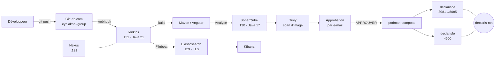
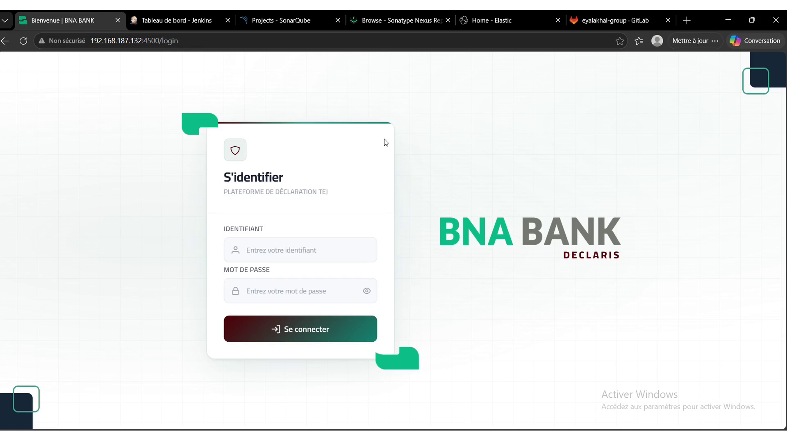
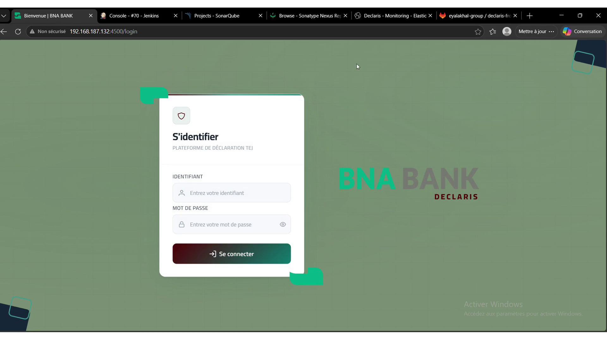
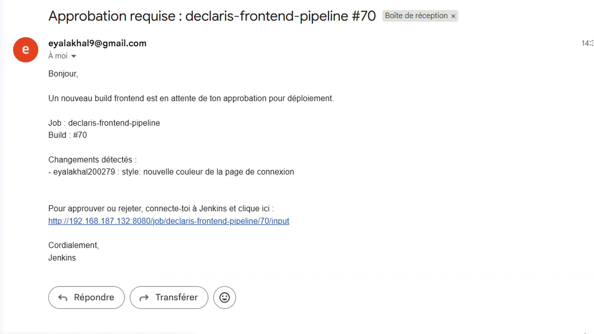
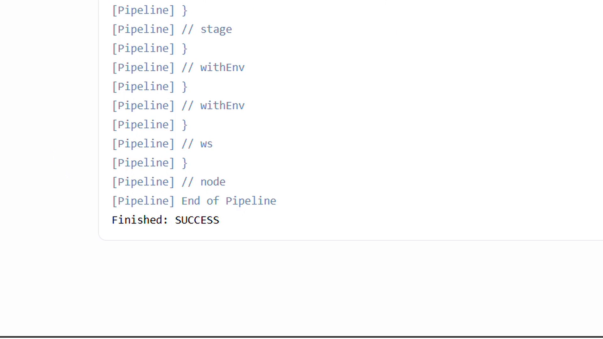

# Declaris — Chaîne CI/CD DevOps

Chaîne d'intégration et de déploiement continus mise en place pour **Declaris**, la plateforme de déclaration fiscale TEJ de **BNA Bank**, dans le cadre d'un stage ingénieur DevOps (08/06/2026 → 08/08/2026).

> Le code applicatif Declaris (Spring Boot / Angular) **n'est pas inclus** : il appartient à BNA Bank et reste hébergé sur GitLab.
> Ce dépôt contient uniquement l'infrastructure : pipelines, conteneurisation, services, supervision et scripts. Toutes les configurations proviennent directement des VM.

**Autrice :** Eya Lakhal — Élève ingénieure TIC, ENIT
**Encadrant professionnel :** Mohamed Ali Toujani (BNA Bank)

---

## Architecture



Détails : [`docs/architecture.md`](docs/architecture.md) · Inventaire des VM : [`docs/vm-inventory.md`](docs/vm-inventory.md)

## Démonstration

🎬 [Vidéo de la démo (1 min 41)](docs/demo/demo-declaris.mp4) : modification du frontend → push → pipeline → approbation → déploiement → page mise à jour.
📸 [Toutes les captures commentées](docs/screenshots/README.md)

| Avant | Après déploiement |
|---|---|
|  |  |

| Approbation par e-mail | Pipeline réussi |
|---|---|
|  |  |

## Machines

| VM | IP | Rôle |
|---|---|---|
| Jenkins | 192.168.187.132 | Jenkins 2.555.3, Podman, Filebeat, conteneurs Declaris |
| SonarQube | 192.168.187.130 | Analyse de qualité |
| Nexus | 192.168.187.131 | Dépôt d'artefacts |
| ELK | 192.168.187.129 | Elasticsearch 8 + Kibana |

## Pipeline (backend et frontend)

| # | Étape | Outil | Rôle |
|---|---|---|---|
| 0 | Déclenchement | Webhook GitLab | Push sur `main` |
| 1 | Clean Workspace | Jenkins | Repartir d'un espace de travail vide |
| 2 | Clone | Git (shallow, `retry(3)`) | Récupérer le code depuis GitLab |
| 3 | Build | Maven (`JDK21`) / `ng build` | Compiler l'application |
| 4 | SonarQube Analysis | SonarQube / SonarScanner | Qualité du code |
| 5 | Trivy Security Scan | Trivy | Vulnérabilités HIGH/CRITICAL de l'image |
| 6 | Validation du déploiement | Email Extension + `input` | Approbation humaine avant déploiement |
| 7 | Deploy avec Compose | Podman + podman-compose | Reconstruction et redémarrage du conteneur |

## Stack technique

| Composant | Version / détail |
|---|---|
| OS | RHEL 9.6 / 9.8 (VMware Workstation Pro, clones) |
| CI | Jenkins 2.555.3, OpenJDK 21, 112 plugins |
| Qualité | SonarQube, OpenJDK 17 |
| Artefacts | Nexus Repository 3 |
| Supervision | Elasticsearch 8 (xpack security + TLS), Kibana, Filebeat (sans Logstash) |
| Conteneurs | Docker (phase 1), puis Podman rootless + podman-compose |
| Sécurité | Trivy, approbation par e-mail, sudo restreint, secrets dans Jenkins Credentials |
| SCM | GitLab.com (`declaris-backend`, `declaris-frontend`, `declaris-deploy`) |

## Structure du dépôt

```
declaris-devops/
├── jenkins/          Jenkinsfiles, jobs (config.xml), plugins, config SonarQube
├── podman/           podman-compose.yml, Dockerfiles, nginx.conf
├── legacy-docker/    Première version Docker (avant la migration vers Podman)
├── sonarqube/        sonar.properties
├── nexus/            nexus.rc, nexus.vmoptions
├── systemd/          nexus.service, sonarqube.service (proposition)
├── elk/              elasticsearch.yml, kibana.yml, filebeat.yml
├── security/         Trivy
├── scripts/          Installation, LVM, Podman, export des VM, vérification des secrets
└── docs/             Architecture, inventaire, dépannage, captures, vidéo de démo
```

## Reproduire l'environnement

1. Créer les VM RHEL 9 ([`docs/vm-inventory.md`](docs/vm-inventory.md)) et agrandir le disque si besoin : `scripts/extend-disk-lvm.sh`
2. Installer les outils :
   - VM Jenkins : `scripts/install-jenkins.sh`, `scripts/setup-podman-jenkins.sh`, `scripts/install-elk.sh filebeat`
   - VM SonarQube : `scripts/install-sonarqube.sh`
   - VM Nexus : `scripts/install-nexus.sh`
   - VM ELK : `scripts/install-elk.sh server`
3. Configurer Jenkins (plugins, outils, identifiants, jobs) : [`jenkins/README.md`](jenkins/README.md)
4. Cloner `declaris-deploy` dans `/var/lib/jenkins/declaris/` : [`podman/README.md`](podman/README.md)
5. Faire un push sur `main` : le pipeline démarre, l'e-mail d'approbation arrive, puis le déploiement se fait.

Accès après déploiement :
- Frontend : `http://192.168.187.132:4500`
- Backend : `http://192.168.187.132:8081`
- SonarQube : `http://192.168.187.130:9000`
- Kibana : `http://192.168.187.129:5601`

## Problèmes rencontrés

Rootless Podman, ports bloqués (`rootlessport`), mapping de ports (4500, 8081→8085), RAM limitée, versions de Java, disque plein (LVM).
Voir [`docs/troubleshooting.md`](docs/troubleshooting.md).

## Sécurité

Aucun secret n'est versionné : tokens, mots de passe et clés de chiffrement ont été masqués (`<MASQUE>`, `${ES_PASSWORD}`).
Avant chaque push, lancer `bash scripts/check-secrets.sh`.
