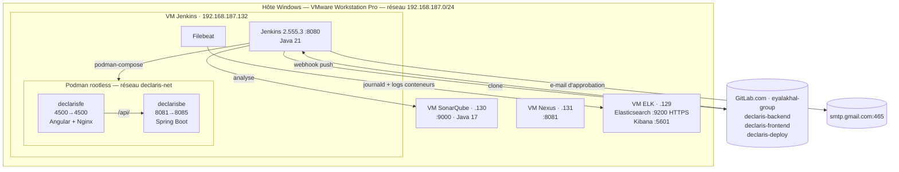
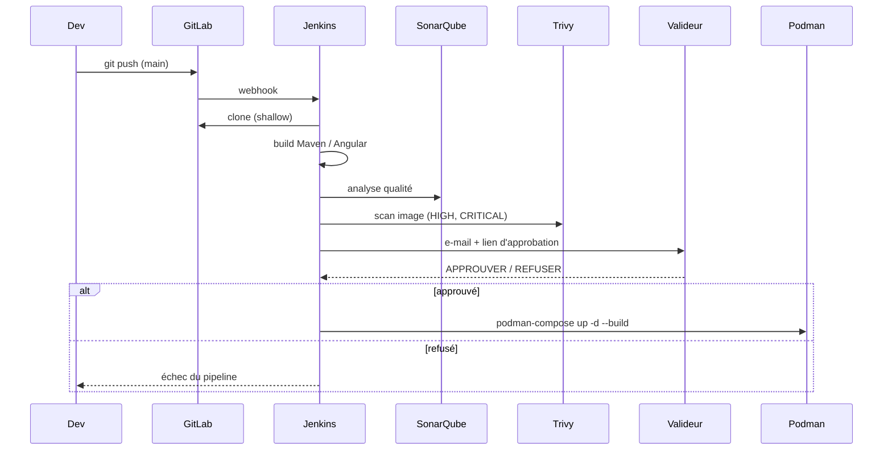

# Architecture

## Vue d'ensemble

## Déroulement d'un build

## Démarche (manuel → automatisé)

1. **Analyse** de la chaîne CI/CD existante de BNA (blueprint fourni)
2. **Déploiement manuel** avec Docker (`legacy-docker/`)
3. **Pipelines Jenkins** déclenchés par webhook GitLab : build, puis SonarQube
4. **Migration vers Podman** rootless + `podman-compose` et réseau `declaris-net`
5. **Sécurité** : scan Trivy et approbation par e-mail
6. **Supervision** : Filebeat → Elasticsearch (TLS) → Kibana
