# Captures — démonstration du pipeline

Captures extraites de la vidéo de démonstration ([`../demo/demo-declaris.mp4`](../demo/demo-declaris.mp4), 1 min 41).
Scénario : on modifie la couleur de la page de connexion, puis on suit le changement jusqu'au déploiement automatique.

## 1. Environnement

| | |
|---|---|
| **Page de connexion avant la modification** |  |
| **Tableau de bord Jenkins** : les 2 pipelines | 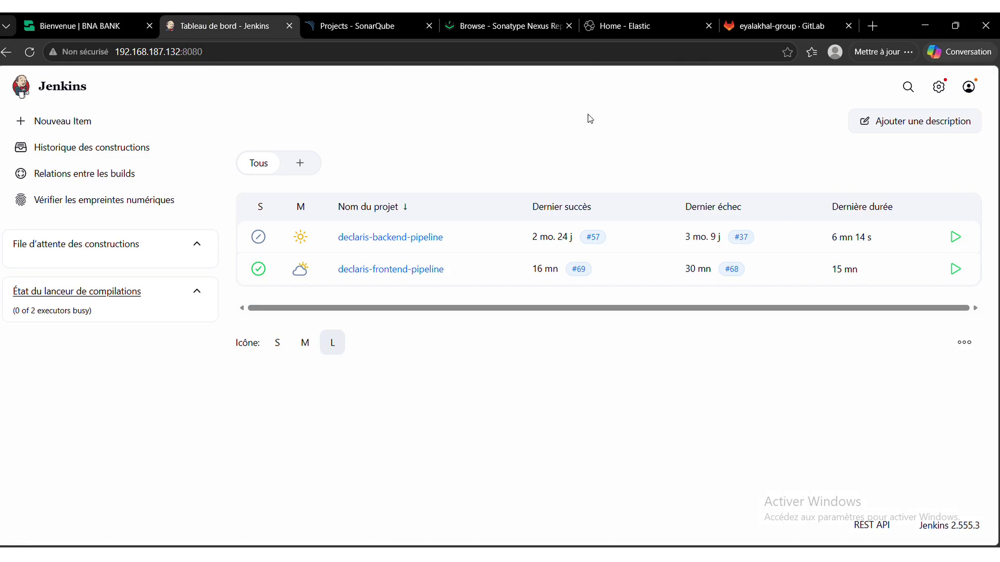 |
| **Groupe GitLab `eyalakhal-group`** : back, backend, deploy, frontend | 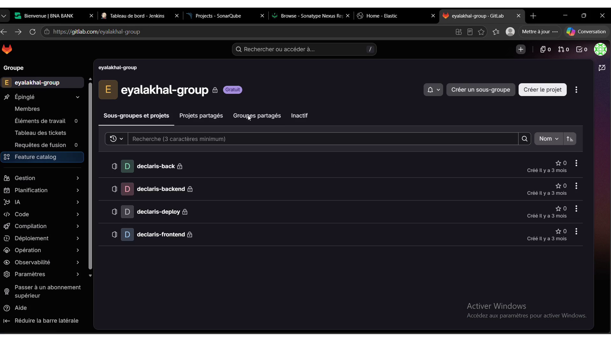 |
| **Nexus Repository** : dépôts maven et nuget | 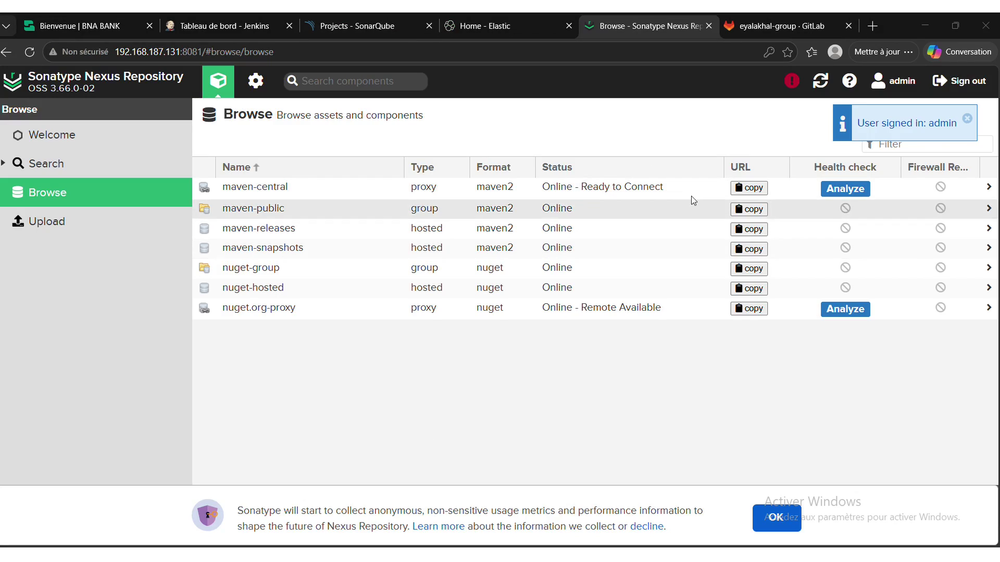 |

## 2. Modification et push

| | |
|---|---|
| **`git diff` / `commit` / `push`** : « style: nouvelle couleur de la page de connexion » | 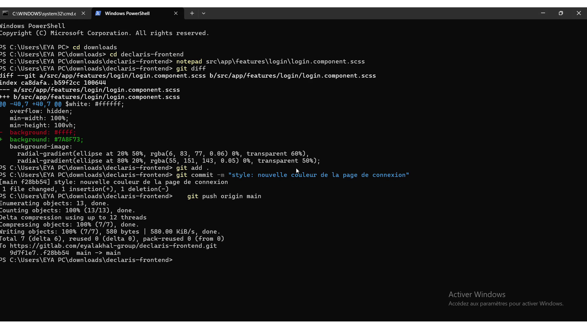 |
| **Commit visible sur GitLab** (`declaris-frontend`) | 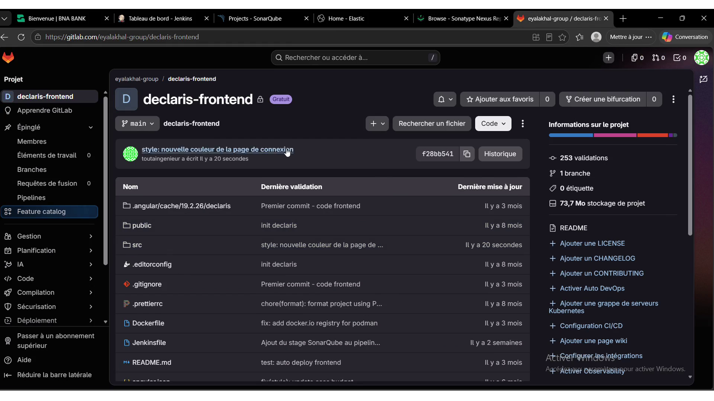 |

## 3. Pipeline Jenkins

| | |
|---|---|
| **Job `declaris-frontend-pipeline`** : SonarQube Quality Gate *Passed* | 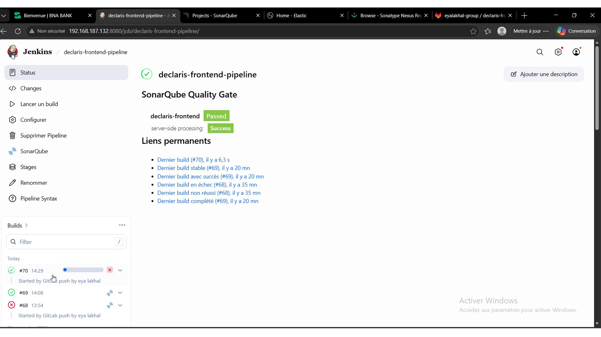 |
| **Build #70 déclenché par le webhook GitLab** | 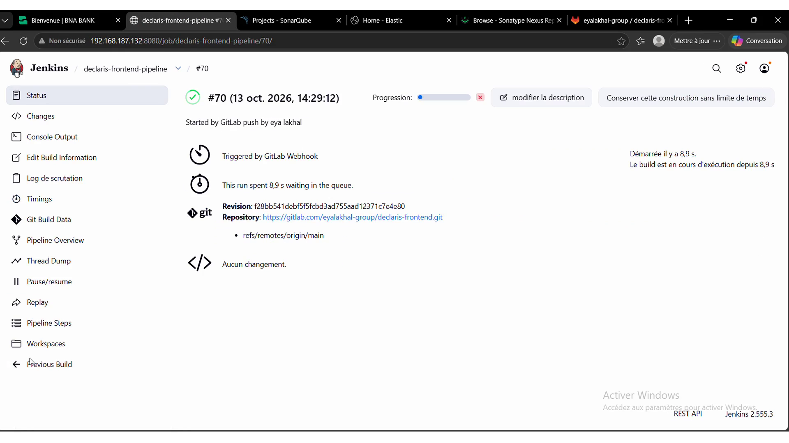 |
| **Analyse SonarScanner** (console) | 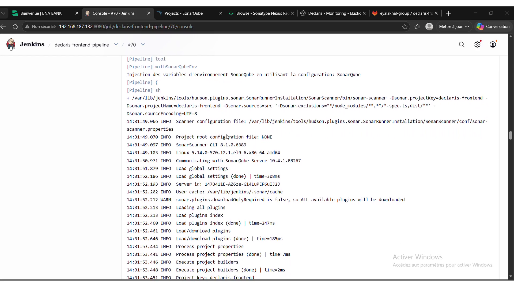 |
| **SonarQube** : `declaris-frontend` *Passed* (37k lignes) | 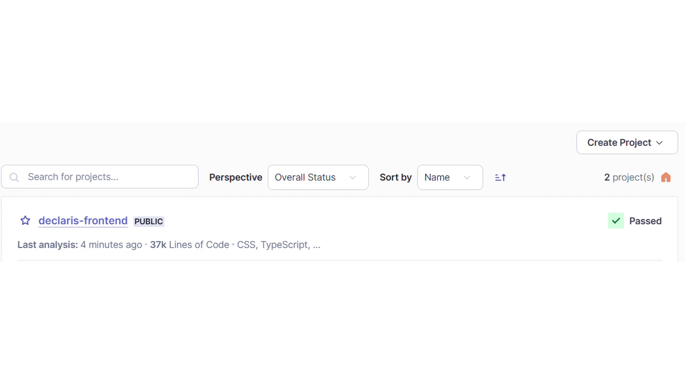 |
| **Rapport Trivy** : image alpine 3.23.5 | 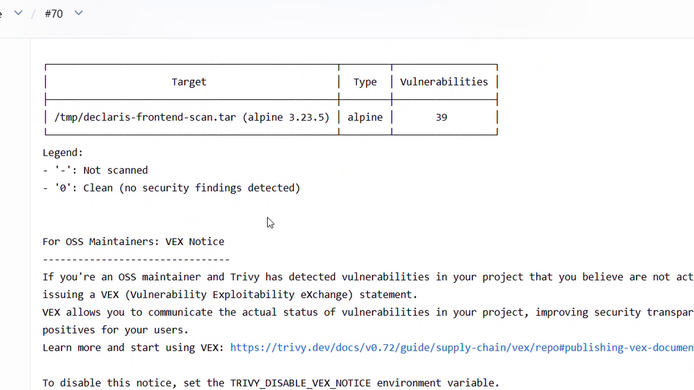 |

## 4. Approbation et déploiement

| | |
|---|---|
| **E-mail d'approbation** avec les changements détectés |  |
| **Choix APPROUVER / REFUSER** dans Jenkins | 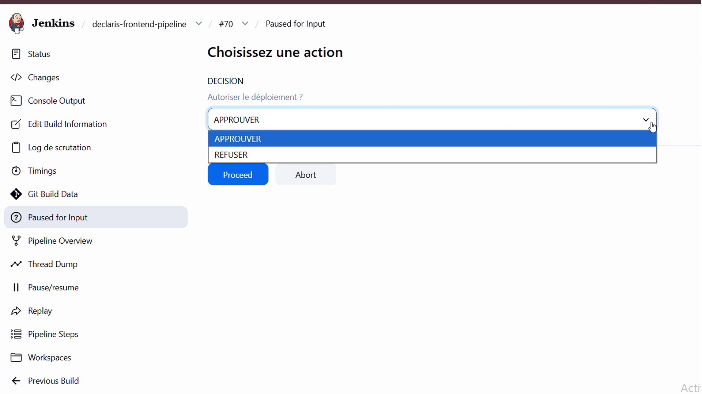 |
| **Déploiement** : `git pull`, puis `podman-compose` | 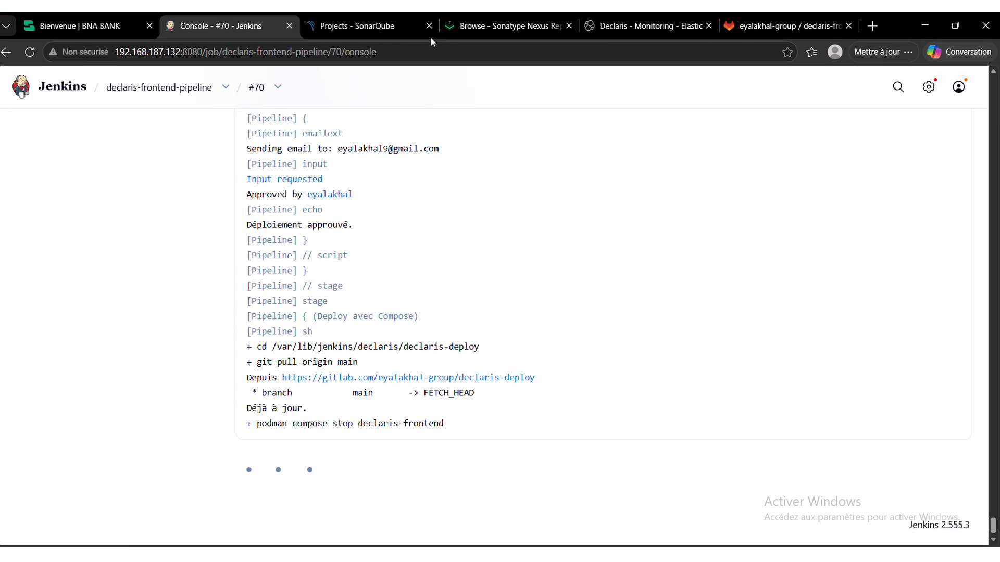 |
| **Pipeline terminé** : `Finished: SUCCESS` |  |

## 5. Supervision et résultat

| | |
|---|---|
| **Dashboard Kibana « Declaris - Monitoring »** : erreurs backend, top URLs, codes HTTP, volume de logs | 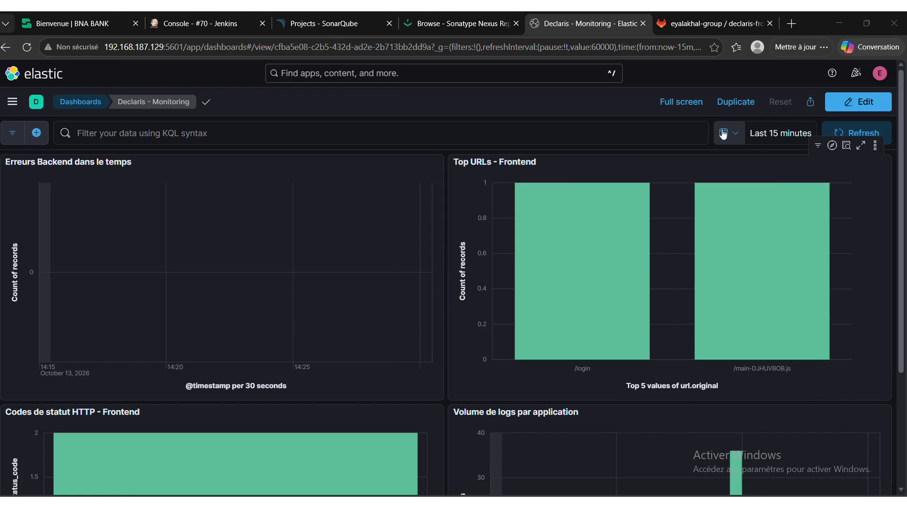 |
| **Page de connexion après le déploiement** : nouvelle couleur |  |
